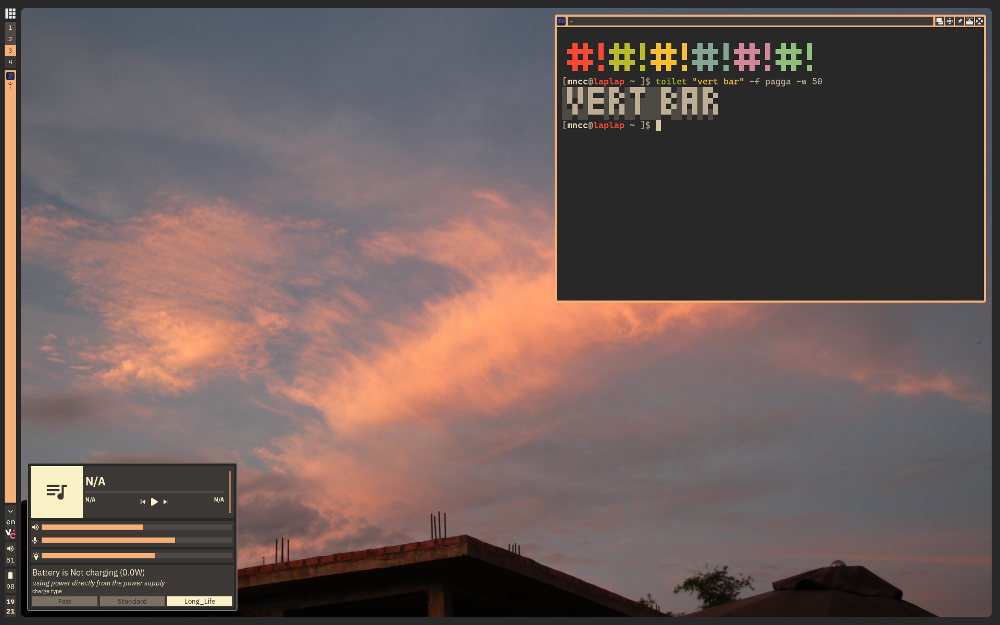

# dotfiles
my .files for arch (btw)
### awm

### hyprland
img not provided bc im lazy
## included config
- nvim
- awesome/somewm
- hyprland
- rofi (copied somewhere else and i don't remember the source)
- alacritty/wezterm/tym
- picom
- some shell scripts collected from internet
## before installing
> [!CAUTION]
> the config is made only for my use, thus it is not stable and will be changed constantly. you should only use this config as a reference.
- install [oh my zsh](https://ohmyz.sh/)
- install these packages, marked (*) items are optional and are used by default:
    - [zsh](https://www.zsh.org/) (shell) (*)
    - [nemo](https://github.com/linuxmint/nemo/) (file explorer) (*)
    - [tym](https://github.com/endaaman/tym) (terminal emulator) (*)
    - [rofi](https://github.com/davatorium/rofi) (app launcher) (*)
    - [playerctl](https://github.com/altdesktop/playerctl) (control mpris2 based media)
    - [themix-theme-oomox](https://github.com/themix-project/oomox-gtk-theme) for dynamic theming
    - libnotify for `notify-send`
    - libpulse (pulseaudio) or pipewire-pulse (pipewire) for pactl
```
yay -S zsh nemo tym rofi playerctl themix-theme-oomox-git libnotify pipewire-pulse
```
- i don't use `bash` anymore so `home/.bashrc` maybe outdated compared to `home/.zshrc`
- these are fonts and cursor theme used by default
    - cascadia-code-nerd
    - ibm-plex
```
yay -S ttf-cascadia-code-nerd ttf-ibm-plex
```
### wayland
- [grim](https://gitlab.freedesktop.org/emersion/grim) and [slurp](https://github.com/emersion/slurp)
- [wl-clipboard](https://github.com/bugaevc/wl-clipboard)
```
yay -S grim slurp wl-clipboard
```
#### somewm (default)
- [somewm](https://awesomewm.org/)
```
yay -S somewm-git
```
#### hyprland
- [hyprland](https://hyprland.org/)
- [hyprpaper](https://github.com/hyprwm/hyprpaper)
- [fabric](https://wiki.ffpy.org/)
```
yay -S hyprland hyprpaper python-fabric-git
```
### X11
- [picom](https://github.com/yshui/picom)
- [maim](https://github.com/naelstrof/maim)
- [i3lock-color](https://github.com/Raymo111/i3lock-color) and [xidlehook](https://gitlab.com/jD91mZM2/xidlehook)
- [xclip](https://github.com/astrand/xclip)
```
yay -S picom-git maim i3lock-color xidlehook xclip
```
#### awesomewm
> [!NOTE]
> to switch from somewm to awm, you need to change the branch of `.config/awesome` to `awm`

- xorg-xinput for `xinput`
- [awesome](https://awesomewm.org/)
- [snixembed](https://git.sr.ht/~steef/snixembed/) (no SNI supports on awm sadly)
```
yay -S awesome-git xorg-xinput snixembed
```
## install
please **do not use** `./tool/create-symlink` because it is for my use only.
```
git clone https://github.com/mncc8337/.dotfiles.git --recurse-submodules
```
